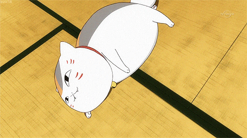

### Eyub Celebioglu

Second-year Master's student in AI, Vision & Robotics at Université de Lorraine (Nancy, France).

I work on machine learning, reinforcement learning and computer vision for robotics. Last year I did my first-year Master's research project with Olivier Buffet (Inria / LORIA) on autonomous navigation in uncertain environments: RRT planning, a shortcut variant called RRTSC, and a DQN agent that follows the planned paths.

I would like to become a researcher, and I am looking for a six-month research internship in 2027.

Most of what's here is coursework or things I built to understand how they work, often from scratch:

- [XOR-NeuralNetwork-CPP](https://github.com/eyub-celebioglu/XOR-NeuralNetwork-CPP): an MLP and backprop in C++ with OpenMP, no ML library
- [snake-DQN](https://github.com/eyub-celebioglu/snake-DQN): deep Q-learning on Snake
- [anime_pictures_generator](https://github.com/eyub-celebioglu/anime_pictures_generator): a DCGAN that generates anime faces
- [3Dengine](https://github.com/eyub-celebioglu/3Dengine) / [Minecraft-cpp](https://github.com/eyub-celebioglu/Minecraft-cpp): an OpenGL engine with physics, then a voxel engine
- [MaidChan](https://github.com/eyub-celebioglu/MaidChan): a voice assistant running local LLMs with Ollama

I mostly write Python (PyTorch) and C++. Outside of that: anime, cats, and a small Unity game with friends.

[website](https://eyub-celebioglu.github.io) · [cv](https://eyub-celebioglu.github.io/cv.pdf) · eyub.celebioglu@gmail.com

```
 /\_/\
( o.o )
 > ^ <
```
